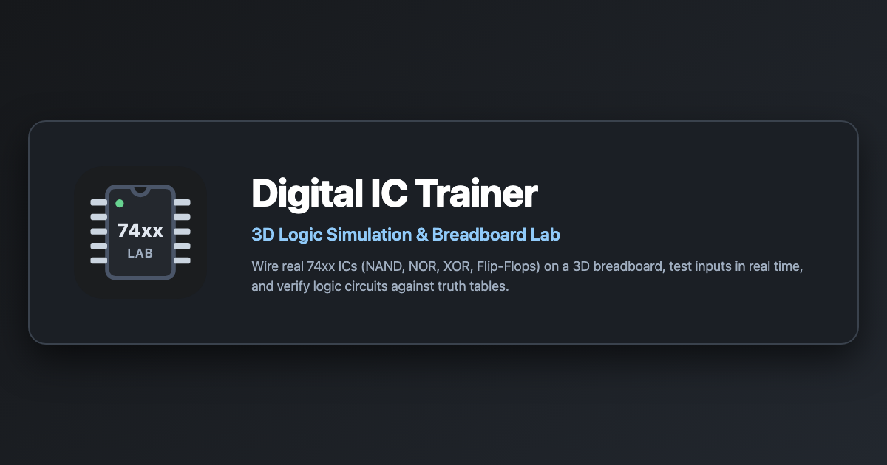

# Digital IC Trainer (3D WebGL Electronics Lab)

An interactive, single-file 3D digital electronics simulator built with Three.js and WebGL. Students can wire 74xx logic ICs on a virtual breadboard, interact with switches and LED indicators in real time, and verify circuits against truth tables in guided Lab mode.

Optimized for instant deployment as a static site on **Vercel** with full mobile-first and desktop support.



---

## ⚡ Features

- **Realistic 3D Hardware Simulation**:
  - Interactive breadboard with tie-point holes, bus strips (+5V & GND rails), and IC sockets.
  - 74xx Series TTL ICs: 7400 (Quad 2-input NAND), 7402 (Quad 2-input NOR), 7404 (Hex Inverter), 7408 (Quad 2-input AND), 7410 (Triple 3-input NAND), 74LS11 (Triple 3-input AND), 7432 (Quad 2-input OR), 7474 (Dual D Flip-Flop), 7486 (Quad 2-input XOR).
  - Power toggle rocker switch, push buttons, slide toggle switches, and LED indicators.
  - Transparent component storage tray with pinout reference views.
- **Guided Lab Experiments**:
  - Step-by-step pin wiring guide with interactive checkpoints.
  - Built-in verification engine: checks power pins (VCC pin 14, GND pin 7), shorts, floating inputs, and validates full truth tables.
  - Experiments include Basic Gates, XOR from NAND, Half/Full Adders, Half Subtractor, De Morgan's Theorems, SOP using NAND ($F = x_1' + x_2 \cdot x_0$), and POS using NOR ($F = (x_2 + x_1')(x_1' + x_0)$).
- **Graphics Quality Controls**:
  - **High** (Desktop default): Adaptive pixel ratio up to 1.5, 1536×1536 directional shadow maps, antialiasing enabled.
  - **Medium** (Mobile default): Adaptive pixel ratio up to 1.0, 1024×1024 shadow maps, antialiasing enabled.
  - **Low**: Pixel ratio capped at 0.75, directional shadows disabled for maximum frame rate on low-end hardware, antialiasing disabled.
  - Saved automatically to `localStorage` across visits.
- **Vercel-Ready Static Architecture**:
  - 3D GLB model (~9.6 MB binary) moved to `assets/model.glb` and streamed via Fetch API with a live loading progress bar.
  - HTML file size reduced to ~830 KB (>93% reduction) for fast transfer and brotli/gzip compression.
  - `vercel.json` with `cleanUrls` and immutable long-term caching for static assets.
- **Progressive Web App (PWA)**:
  - Valid `manifest.json`, high-resolution icons (192×192, 512×512), and SVG favicon.

---

## 🚀 Getting Started

No build step or heavy framework is required. It is plain HTML, CSS, and JavaScript.

### Running Locally

You can serve the folder with any static file server:

```bash
# Using Node built-in HTTP server or npx serve:
npx serve .
# Or Python:
python3 -m http.server 3000
```

Open `http://localhost:3000` in any WebGL-capable browser.

---

## 🧪 Automated Testing

Automated end-to-end tests run with Playwright and a local static HTTP server:

```bash
# Install test dependencies (first time only):
npm install

# Run both circuit truth-table verification and UI feature tests:
npm test
```

### Test Suites:
- `npm run test:circuits`: Programmatically wires SOP (NAND) and POS (NOR) circuits using `window.T` hooks and validates that all 8 truth-table rows pass.
- `npm run test:ui`: Tests Quality switching, `localStorage` persistence, the Help dialog, and mobile layout at 400×800.

---

## 📦 Deployment to Vercel

### Option 1: GitHub Integration (Recommended)
1. Import this repository (`pranavcs129/hardwarelabchayando`) into your Vercel dashboard.
2. Leave the Framework Preset as **Other** and Build Command empty.
3. Deploy!

### Option 2: Vercel CLI
```bash
npx vercel --prod
```

---

## 📄 License

MIT License. See [CHANGELOG.md](CHANGELOG.md) for version history.

